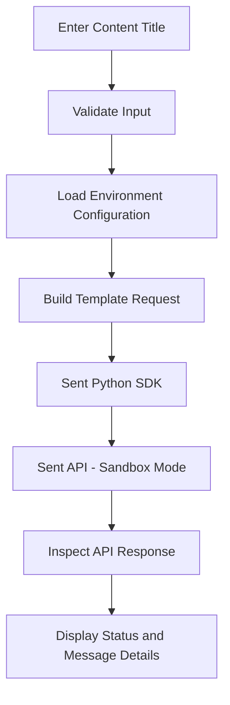

# Sent Creator Drop

A Python integration prototype connecting creator content input to the [Sent messaging API](https://docs.sent.dm/) using configurable message templates and sandbox testing.

## Overview

Sent Creator Drop demonstrates how a small application can take a content title, insert it into a configured messaging template, submit a request through the Sent Python SDK, and inspect the API response.

The project was built to explore practical API integration, reusable Python modules, environment-based configuration, error handling, and safe testing practices.

**Current status:** Working sandbox prototype. Live message delivery is intentionally disabled.

## How It Works



The application separates the terminal interface from the API communication logic, making the integration easier to understand, maintain, and extend.

## Features

- **Template-based messaging:** Passes a content title into the configured `contentTitle` template parameter.
- **API integration:** Uses the Sent Python SDK to construct and submit messaging requests.
- **Environment-based configuration:** Loads credentials and settings from a local `.env` file.
- **Error handling:** Handles common connection, rate-limit, API, and configuration errors.
- **Modular design:** Separates application flow from the reusable messaging client.
- **Sandbox-first testing:** Validates the integration without delivering real messages.
- **Secret protection:** Uses `.gitignore` to exclude local credentials and development artifacts from version control.

## Tech Stack

- Python
- [Sent Python SDK](https://docs.sent.dm/sdks/python) (`sentdm`)
- `python-dotenv`
- Sent messaging API
- Git and GitHub

## Project Structure

```text
sent-creator-drop/
├── .env.example       # Configuration template
├── .gitignore         # Excludes secrets and local files
├── README.md          # Project documentation
├── requirements.txt   # Python dependencies
├── check_config.py    # Configuration check
├── main.py            # Application entry point
├── sent_client.py     # Sent API communication
└── test_sandbox.py    # Sandbox test script
```

## Getting Started

### Prerequisites

- Python installed on your system
- A Sent account and API key
- A configured Sent message template
- An authorized test recipient for your account

### 1. Clone the repository

```bash
git clone https://github.com/MagiSamStar/sent-creator-drop.git
cd sent-creator-drop
```

### 2. Create a virtual environment

**Windows PowerShell**

```powershell
python -m venv .venv
.\.venv\Scripts\Activate.ps1
```

**macOS / Linux**

```bash
python3 -m venv .venv
source .venv/bin/activate
```

### 3. Install dependencies

```bash
pip install -r requirements.txt
```

### 4. Configure environment variables

Create a local `.env` file by copying `.env.example`.

**Windows PowerShell**

```powershell
Copy-Item .env.example .env
```

**macOS / Linux**

```bash
cp .env.example .env
```

Add your own configuration values to `.env`:

| Variable           | Purpose                                    |
| ------------------ | ------------------------------------------ |
| `SENT_DM_API_KEY`  | Authenticates with the Sent API            |
| `SENT_TEMPLATE_ID` | Identifies the configured message template |
| `SENT_TEST_PHONE`  | Specifies the test recipient               |

Keep your real credentials in `.env`. Never commit API keys, private tokens, or personal recipient information to GitHub.

### 5. Check configuration

```bash
python check_config.py
```

### 6. Run the application

```bash
python main.py
```

Enter a content title when prompted. The application submits a template-based request in sandbox mode and displays the returned status and available message details.

## Sandbox Testing and Safety

The integration currently uses `sandbox=True` in the API request.

Sandbox mode allows the request to be tested without delivering a real message. A response status such as `QUEUED` in sandbox mode does **not** mean a notification was delivered to a recipient.

Live message delivery is outside the current project scope.

## Engineering Concepts Demonstrated

This project provides hands-on experience with:

- API client initialization and request construction
- Python functions, modules, imports, and return values
- Environment variables and credential management
- Template parameters and structured API responses
- Exception handling and failure reporting
- Separating application logic from external service communication
- Git version control and project documentation
- Testing integrations without triggering real-world side effects

## Future Improvements

Potential next steps include:

- Add automated tests for input validation and error handling.
- Improve configuration validation and user-facing diagnostics.
- Add structured logging for debugging.
- Expand the workflow to support multiple content types or templates.
- Create a short demonstration showing the request lifecycle.

## Project Status

**Working prototype — sandbox integration verified.**

Built as a hands-on exploration of API integration and Python application design. The project is not intended to be a production-ready messaging service.

## Author

**MagiSamStar**

[GitHub Profile](https://github.com/MagiSamStar)
